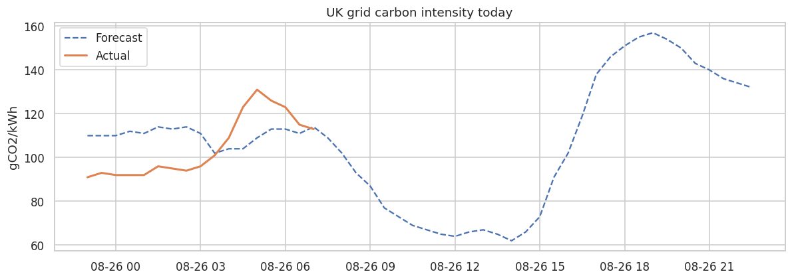
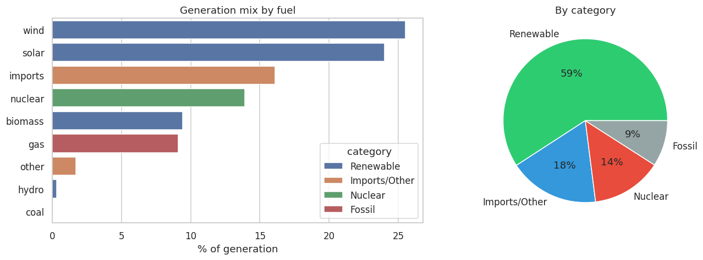

# UK Carbon Intensity — Real-Time Grid Analytics ⚡

A **real-time** data application that pulls **live** UK electricity grid data from the National Grid ESO **Carbon Intensity API** (no API key required) and turns it into an interactive dashboard: current carbon intensity, forecast-vs-actual tracking, the live generation mix, and the greenest time of day to use electricity.

**Stack:** Python · requests · pandas · Streamlit · Plotly · pytest · Docker · GitHub Actions

   

---

## Why this project

Most portfolio projects use a static CSV. This one consumes a **live API**, so the dashboard shows different numbers every time it loads — demonstrating real data-engineering concerns: HTTP clients, retries, caching, response parsing, graceful fallback, and testing against real fixtures.

## Live demo

Deploys free on **Streamlit Community Cloud** (which has internet, so it fetches live data): push to GitHub → [share.streamlit.io](https://share.streamlit.io) → point at `app.py`.

> _Add your live URL here once deployed, e.g._ `https://uk-carbon-intensity.streamlit.app`

## What it shows

| Feature | Detail |
|---|---|
| **Current intensity** | Live gCO₂/kWh and the national "index" (low / moderate / high) |
| **Forecast vs actual** | Today's 48 half-hourly periods, forecast against settled actuals |
| **Forecast accuracy** | Mean absolute error between forecast and actual |
| **Generation mix** | Live breakdown by fuel (wind, solar, gas, nuclear, …) and category |
| **Greenest window** | The half-hour today with the lowest intensity — when to run flexible loads |
| **Auto-refresh** | Cached for 5 minutes; a button forces a fresh live pull |
| **Live/sample indicator** | A green banner confirms live API data; an orange banner warns if the app fell back to saved sample data |
| **UK local time** | All times are converted from UTC to UK time (GMT/BST) |

## Example live findings

*(a snapshot — the app updates every 30 minutes as the grid changes)*

- Renewables **~59%** of generation, low-carbon (incl. nuclear) **~73%**
- Greenest half-hour **~62 gCO₂/kWh at 14:00** (solar peak); dirtiest **~157 at 19:00** (evening gas)
- Published forecast tracks actuals closely — **MAE ≈ 14 gCO₂/kWh**

### Dashboard & analysis




## Architecture

```
uk-carbon-intensity/
├── app.py                  # real-time Streamlit dashboard
├── src/
│   ├── api.py              # live API client: retries, caching, offline fallback
│   ├── transform.py        # JSON -> tidy pandas DataFrames
│   ├── insights.py         # greenest window, renewable share, forecast accuracy
│   └── config.py
├── notebooks/
│   └── 01_carbon_intensity_analysis.ipynb
├── check_api.py            # one-line check that the live API is reachable
├── tests/test_pipeline.py  # 7 offline tests (incl. live vs fallback handling)
├── data/                   # real sample API responses (offline fallback)
├── reports/figures/
├── Dockerfile
├── requirements.txt
└── .github/workflows/ci.yml
```

The API client fetches live data on every call; if the network is unavailable (e.g. offline CI), it falls back to **bundled real sample responses**, so the app and tests run anywhere.

## Quick start

```bash
pip install -r requirements.txt
python check_api.py                               # confirm you can reach the live API
streamlit run app.py                              # live dashboard
jupyter notebook notebooks/01_carbon_intensity_analysis.ipynb
pytest -q                                          # tests (offline)
```

Docker:

```bash
docker build -t uk-carbon-intensity .
docker run -p 8501:8501 uk-carbon-intensity
```

## Data source

National Grid ESO **Carbon Intensity API** — <https://carbonintensity.org.uk> · free, open, no key.
Endpoints used: `/intensity`, `/intensity/date`, `/generation`, `/intensity/{from}/{to}`.

## Next steps

- Persist snapshots to build a long-term history (scheduled job + database).
- Add the **regional** endpoint for a UK map view.
- A short forecasting model to predict tomorrow's greenest window.

---

*Author: **Jai Sooryah Gunaseelan** — MSc Data Science & Analytics, University of Leeds · [LinkedIn](https://www.linkedin.com/in/jai-sooryah-gunaseelan)*
